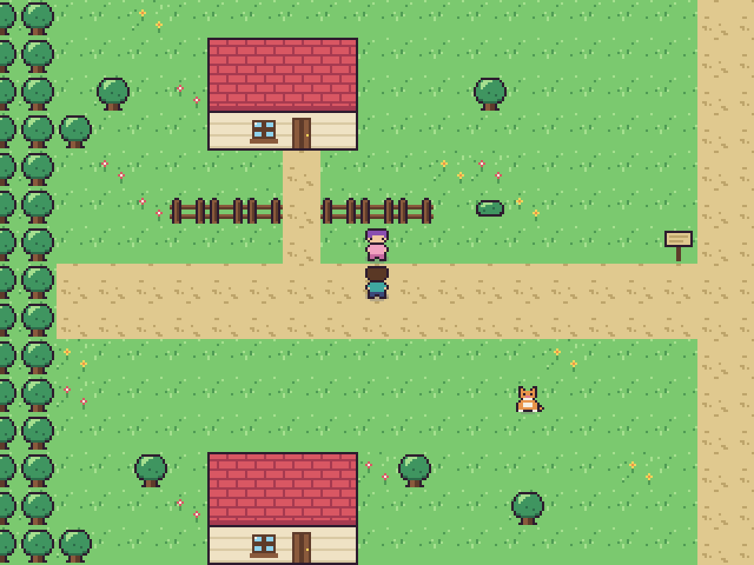
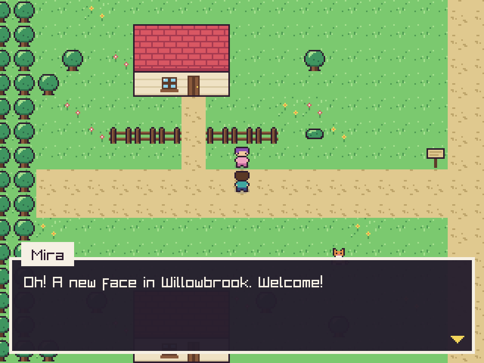
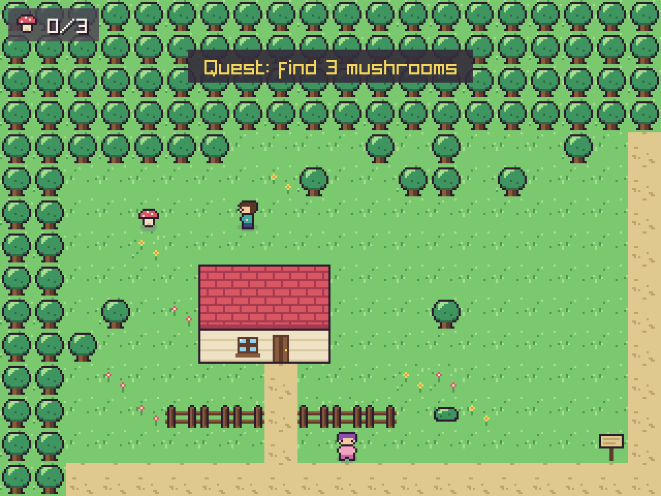
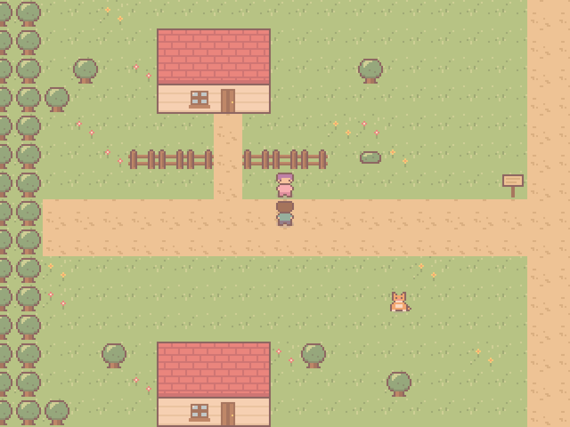

# Willowbrook

A tiny cozy village game in **C++17 + [raylib](https://www.raylib.com/)**. Walk around, talk to the villagers, pet (well, talk to) the cat, and help Mira find the mushrooms for her soup.

All the pixel art is drawn **in code** (sprites are 16x16 grids of characters), so there are no image files to load. The whole game is a few hundred lines you can read in one sitting.



| Talk to villagers | Find the mushrooms | Finish the quest |
| :---: | :---: | :---: |
|  |  |  |

## Features

- Scrolling tile map with a village, forest, pond, houses and paths
- Smooth 4-direction movement with a walk animation and wall sliding
- NPC dialogue with a typewriter effect and a name tag
- A small quest (find 3 mushrooms) with a HUD counter, toasts, and an ending where the sky turns golden
- Signs, doors, and a blinking cat to interact with
- Crisp pixel scaling at any window size

## Controls

| Key | Action |
| --- | --- |
| Arrow keys / WASD | Move |
| Z / Space / Enter / E | Talk, read, continue |
| Esc | Quit |

## Build and run

You need a C++17 compiler and [CMake](https://cmake.org/) 3.15+. raylib is downloaded and built automatically if it isn't installed.

```bash
git clone https://github.com/ash07x-x/willowbrook.git
cd willowbrook
cmake -B build
cmake --build build
./build/willowbrook        # on Windows: build\Debug\willowbrook.exe
```

On Linux you may first need raylib's system libraries:

```bash
sudo apt install build-essential git cmake libasound2-dev libx11-dev libxrandr-dev \
  libxi-dev libgl1-mesa-dev libglu1-mesa-dev libxcursor-dev libxinerama-dev
```

## How it works

```
src/
  main.cpp      window + game loop, reads the keyboard into an Input struct
  game.cpp/hpp  game state: movement, collision, dialogue, quest, drawing
  world.cpp/hpp the map: built in code from paths, houses, a pond and scattered trees
  sprites.cpp   all pixel art + the code that turns it into textures
tools/
  capture.cpp   plays the game with scripted input and saves the README screenshots
```

A few ideas worth knowing about:

- **Render texture scaling.** The game draws into a tiny 320x240 texture, which is then scaled up by a whole number to fill the window. That is what keeps the pixels sharp.
- **Art as text.** Each sprite is 16 strings of 16 characters, and each letter maps to a colour in a palette. Recolouring a character is just a different palette.
- **Deterministic "randomness".** Trees, bushes and flowers are placed with an integer hash of their tile position, so the village looks the same on every run without saving any map data.
- **Axis-separated collision.** The player moves on X and Y separately and tests a small "feet box" against solid tiles and NPCs, which makes you slide along walls instead of getting stuck.
- **Input is separate from the game.** `Game` takes an `Input` struct instead of reading the keyboard, so `tools/capture.cpp` can play a full scripted run (and fails if the quest can't be completed), which doubles as an end-to-end test.

Regenerate the screenshots with:

```bash
cmake --build build --target capture
./build/capture docs/screenshots
```

## Make it your own

- **Redraw the art:** edit the character grids in `src/sprites.cpp`, or change the colours in `basePalette()`.
- **Rearrange the village:** change the positions at the top of `src/world.hpp` and the house / path calls in `World::generate()`.
- **Add a villager:** add an entry to `npcs_` in `Game::init()` and a branch for their name in `Game::talkToNpc()`.
- **Write a new quest:** the quest is a small state machine (`Quest::NotStarted` -> `Active` -> `Ready` -> `Done`). Add states or a second collectible.

## Ideas for what's next

- Sound effects and music (raylib has `InitAudioDevice`)
- Load maps from a Tiled (`.tmx`) file instead of building them in code
- Day/night cycle, weather, an inventory
- Replace the generated art with your own Aseprite sprites and a texture atlas
- A web build with Emscripten, so it's playable from a link

## License

MIT, see [LICENSE](LICENSE).
